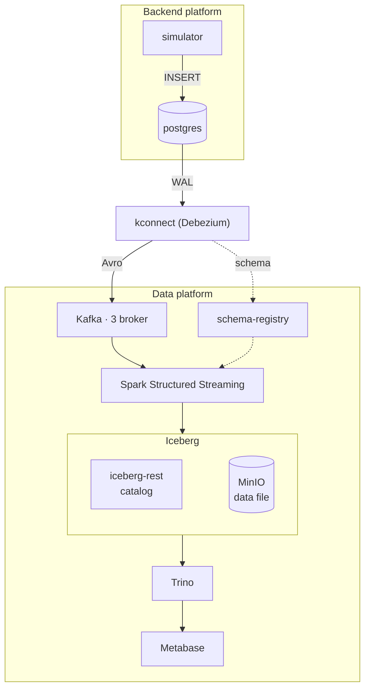
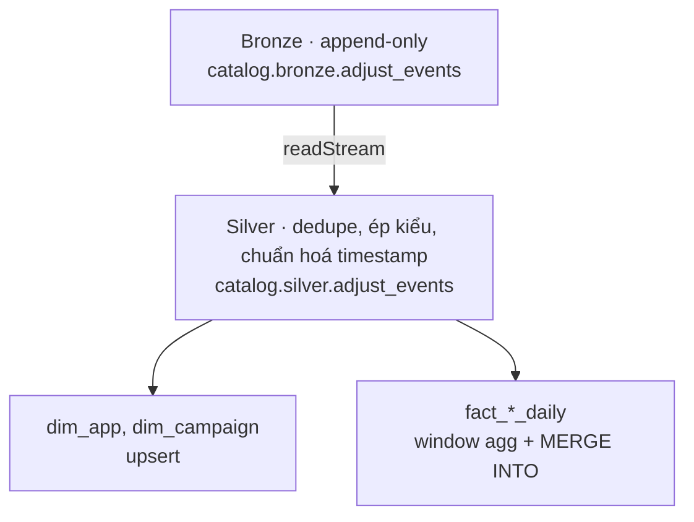

# Mobile App Event Streaming

Pipeline streaming cho event của mobile app (install, ad revenue, subscription): app ghi event vào Postgres, Debezium đẩy thay đổi (CDC) sang Kafka, Spark Structured Streaming ghi vào lakehouse Iceberg, Trino và Metabase để truy vấn và làm dashboard. Dữ liệu mô phỏng theo định dạng attribution của Adjust.

## Mục lục

1. [Kiến trúc tổng quan](#kiến-trúc-tổng-quan)
2. [Kiến trúc thành phần](#kiến-trúc-thành-phần)
   - [Backend platform](#backend-platform)
   - [Hợp đồng CDC](#hợp-đồng-cdc)
   - [Data platform](#data-platform)
   - [Các tầng dữ liệu](#các-tầng-dữ-liệu)
3. [Cài đặt và chạy](#cài-đặt-và-chạy)
4. [CI/CD](#cicd)
5. [Port và truy cập](#port-và-truy-cập)

## Kiến trúc tổng quan

Hệ thống chia làm 2 platform, mỗi platform một network Docker riêng, chỉ nối với nhau qua CDC. Backend sở hữu Postgres; data platform chỉ đọc WAL qua Debezium, không kết nối trực tiếp tới Postgres.

`kconnect` nằm giữa vì là service duy nhất gắn cả hai network. Nét liền là luồng dữ liệu, nét đứt là schema. Service phụ trợ (kafka-ui, spark-history-server, tooling-db...) không vẽ, xem ở [Data platform](#data-platform).

| | Backend platform | Data platform |
|---|---|---|
| Vai trò | OLTP: app ghi event | CDC → Kafka → Spark → Iceberg → BI |
| Network | `backend-net` | `kafka-net` |
| Compose | [postgres](compose/postgres.yml), [simulator](compose/simulator.yml) | [kafka](compose/kafka.yml), [storage](compose/storage.yml), [tooling-db](compose/tooling-db.yml), [spark](compose/spark.yml), [bi](compose/bi.yml) |
| Code, config | [simulator/](simulator/), [docker/simulator/](docker/simulator/), [ddl/postgresql/](ddl/postgresql/), [config/postgres/](config/postgres/) | [spark/](spark/), [docker/spark/](docker/spark/), [schema/](schema/), [trino/](trino/), [ddl/tooling/](ddl/tooling/) |
| Test | [tests/simulator/](tests/simulator/), [tests/postgres/](tests/postgres/) | chưa có |
| CI/CD | [backend-platform.yml](.github/workflows/backend-platform.yml) → image `simulator` | [data-platform.yml](.github/workflows/data-platform.yml) → image `spark` |

## Kiến trúc thành phần

### Backend platform

| Service | Vai trò |
|---|---|
| simulator | FastAPI sinh event install/ad-revenue/subscription ngẫu nhiên, ghi vào bảng `adjust.event`. |
| postgres | OLTP, chạy `wal_level=logical` cho CDC ([postgresql.conf](config/postgres/postgresql.conf)). Simulator và Debezium dùng user riêng theo quyền tối thiểu ([02-roles.sh](ddl/postgresql/02-roles.sh)); superuser chỉ để quản trị. |

### Hợp đồng CDC

Chỗ duy nhất hai platform phụ thuộc nhau. Đổi cấu trúc `adjust.event` là đổi hợp đồng, phải sửa cả hai phía.

- **Backend đảm bảo** (kiểm tra bởi [tests/postgres/](tests/postgres/)): `wal_level=logical`; bảng `adjust.event` có `REPLICA IDENTITY FULL`; publication `dbz_publication` chỉ chứa `adjust.event`, publish đủ insert/update/delete/truncate; user `PG_DEBEZIUM_USER` có `REPLICATION` và `SELECT` trên bảng.
- **Data platform dùng**: topic `adjust-dbserver.adjust.event`, value Avro, schema ở subject `adjust-dbserver.adjust.event-value` trên schema-registry.

### Data platform

| Nhóm | Service | Vai trò |
|---|---|---|
| Ingestion | kconnect | Debezium đọc WAL, ghi vào topic `adjust-dbserver.adjust.event`. Connector phải đăng ký tay ([Cài đặt](#cài-đặt-và-chạy) bước 4). |
| | kafka1/2/3 | Cluster 3 broker, chế độ KRaft. |
| | schema-registry | Lưu Avro schema: kconnect ghi vào, Spark đọc ra để decode. |
| | kafka-ui | UI read-only xem topic, schema, connector; cần đăng nhập. |
| Processing | spark-master, spark-worker-1/2 | Chạy các job streaming khai báo trong `CONFIG_JOBS` ([spark_builder.py](spark/spark_builder.py)). |
| | spark-history-server | Xem lại job đã chạy. Chưa bật `spark.eventLog` nên hiện trống. |
| Lakehouse | iceberg-rest | Iceberg REST catalog dùng chung cho Spark và Trino; metadata lưu ở tooling-db. |
| | minio, minio-init | Object storage S3: bucket `lakehouse` (warehouse `s3://lakehouse/<ENV>`) và `data` (checkpoint Spark). `minio-init` tạo bucket lúc start. |
| | tooling-db | Postgres cho công cụ: catalog của iceberg-rest và app DB của Metabase. Không liên quan postgres của backend. |
| Serving | trino | SQL trên bảng Iceberg qua iceberg-rest ([iceberg.properties](trino/catalog/iceberg.properties)). |
| | metabase | Dashboard, query qua Trino. |

### Các tầng dữ liệu

Bảng Iceberg đặt tên theo `catalog.<tầng>.<bảng>`. Hiện mới có Bronze; Silver và Gold là thiết kế dự kiến (`spark/silver`, `spark/gold` còn trống).

- **Bronze** ([sink_to_bronze.py](spark/bronze/sink_to_bronze.py)): đọc Kafka, decode Avro, append vào Iceberg, partition theo `event_date`.
- **Silver**: đọc lại Bronze bằng `readStream`, dedupe theo `id`, ép kiểu, chuẩn hoá timestamp; vẫn partition theo `event_date`.
- **Gold**: dimension (`dim_app`, `dim_campaign`) upsert bằng `foreachBatch` + `MERGE INTO`. Fact (`fact_installs_daily`, `fact_revenue_daily`, `fact_ad_revenue_daily`, `fact_subscription_daily`, `fact_events_daily`) aggregate theo window có watermark rồi `MERGE INTO`, vì mỗi micro-batch có thể cập nhật lại số của cùng một ngày.

## Cài đặt và chạy

[docker-compose.yml](docker-compose.yml) chỉ là entry point, `include:` các file trong [compose/](compose/); đường dẫn và `.env` resolve từ gốc repo. Dựng server trên AWS bằng Terraform: xem [infra/aws/](infra/aws/).

1. Copy `.env.example` thành `.env`, điền password Postgres (`PG_PASSWORD`, `PG_DEBEZIUM_PASSWORD`), credentials MinIO (`AWS_ACCESS_KEY_ID`, `AWS_SECRET_ACCESS_KEY` tối thiểu 8 ký tự), `TOOLING_DB_PASSWORD`, `KAFKA_UI_PASSWORD`. Trên server đặt `BIND_ADDR` = IP interface VPN. Password superuser Postgres nằm ở `secrets/pg_superuser_password` (không commit), `make postgres-up` tự sinh nếu chưa có.
2. Khởi động: `make postgres-up kafka-up minio-up simulator-up trino-up metabase-up` (chạy tuần tự).
3. DDL trong [ddl/postgresql/](ddl/postgresql/) tự chạy khi volume `postgres-db-volumes` còn trống.
4. `make register-connector` để đăng ký connector Debezium (không persist, phải chạy lại sau khi wipe volume). Kiểm tra bằng `make connector-status` hoặc Kafka UI. Password Debezium đọc từ `secrets/debezium.properties` (`make kafka-up` sinh từ `PG_DEBEZIUM_PASSWORD`).
5. `make spark-up` (start cluster rồi submit) hoặc `make spark-submit` nếu cluster đã chạy.
6. `make check-exposure` để xác nhận không port nào bind ra ngoài `127.0.0.1`/`BIND_ADDR`.

**Đổi password trên stack đang chạy** (password của image Postgres chỉ áp dụng lúc initdb):

- **Postgres OLTP** (`PG_PASSWORD`, `PG_DEBEZIUM_PASSWORD`): `make postgres-roles kconnect-secret` → `docker compose up -d simulator` → `docker compose restart kconnect`.
- **tooling-db** (`TOOLING_DB_PASSWORD`): `make tooling-db-roles`.
- **MinIO root** (`AWS_ACCESS_KEY_ID`/`AWS_SECRET_ACCESS_KEY`): `docker compose up -d minio minio-init iceberg-rest trino`, rồi dừng job Spark và `make spark-submit` lại.

## CI/CD

GitHub Actions, mỗi platform một workflow, chỉ chạy khi đổi file thuộc platform đó. Chạy trên runner của GitHub, không cần server riêng.

| Job | Làm gì |
|---|---|
| `lint` | `ruff`; data-platform validate thêm Avro schema |
| `test` | Unit test simulator (backend) |
| `integration` | Dựng postgres thật bằng `make postgres-up`, chạy `tests/postgres` với `REQUIRE_DB=1` (không có DB là fail, không skip) (backend) |
| `docker-build` | Build image, `docker compose config`, `check_exposure.py` |
| `publish` | Chỉ khi push `main` hoặc chạy tay, sau khi mọi job xanh: đẩy image lên GHCR |

CD hiện tại là publish image (chưa có server): `ghcr.io/trucni2005/adjust-streaming-project/{simulator,spark}`, tag `sha-<commit>` (dùng để deploy/rollback) và `latest`. Package private thì server cần `docker login ghcr.io` bằng PAT có quyền `read:packages`.

Chạy integration giống CI ở local: `make postgres-up && REQUIRE_DB=1 make test-postgres`.

## Port và truy cập

Docker publish port bằng iptables riêng nên **bỏ qua ufw**. Quy tắc:

- Service **không có auth** chỉ bind `127.0.0.1`; truy cập từ xa bằng SSH tunnel qua VPN, ví dụ `ssh -L 7070:127.0.0.1:7070 <host-vpn>`.
- Service **có đăng nhập** bind `BIND_ADDR` (`127.0.0.1` hoặc IP interface VPN).
- Service chỉ dùng nội bộ thì không publish.

| Service | Port host | Bind | Ghi chú |
|---|---|---|---|
| Postgres | 5434 | `127.0.0.1` | 5432 trong container |
| Simulator | 8000 | `127.0.0.1` | `POST /events/install` không có auth |
| Schema Registry | 8081 | `127.0.0.1` | không có auth |
| Kafka Connect | 8083 | `127.0.0.1` | REST API không có auth |
| Kafka UI | 8086 | `BIND_ADDR` | cần đăng nhập, read-only |
| Spark master UI | 7070 | `127.0.0.1` | 8080 trong container, đã tắt nút kill |
| Spark driver UI | 4040 | `127.0.0.1` | chỉ lên khi có job |
| Spark worker 1 / 2 UI | 8091 / 8092 | `127.0.0.1` | |
| Spark History Server | 18080 | `127.0.0.1` | |
| Trino | 8050 | `127.0.0.1` | chưa bật auth |
| Metabase | 3000 | `BIND_ADDR` | cần đăng nhập |
| MinIO Console | 9001 | `BIND_ADDR` | đăng nhập bằng `AWS_ACCESS_KEY_ID`/`AWS_SECRET_ACCESS_KEY` |

Không publish, chỉ truy cập trong Docker network:

| Service | Địa chỉ nội bộ | Debug |
|---|---|---|
| Kafka broker | `kafka1:9092,kafka2:9092,kafka3:9092` | Kafka UI, hoặc `docker exec kafka1 kafka-console-consumer --bootstrap-server kafka1:9092 ...` |
| Spark master RPC | `spark-master:7077` | không có auth (tới được là submit được code); submit qua `make spark-submit` |
| MinIO API | `minio:9000` | MinIO Console |
| Iceberg REST catalog | `iceberg-rest:8181` | không có auth; query qua Trino |
| tooling-db | `tooling-db:5435` | `docker compose exec tooling-db psql -U admin -d metabase` |
