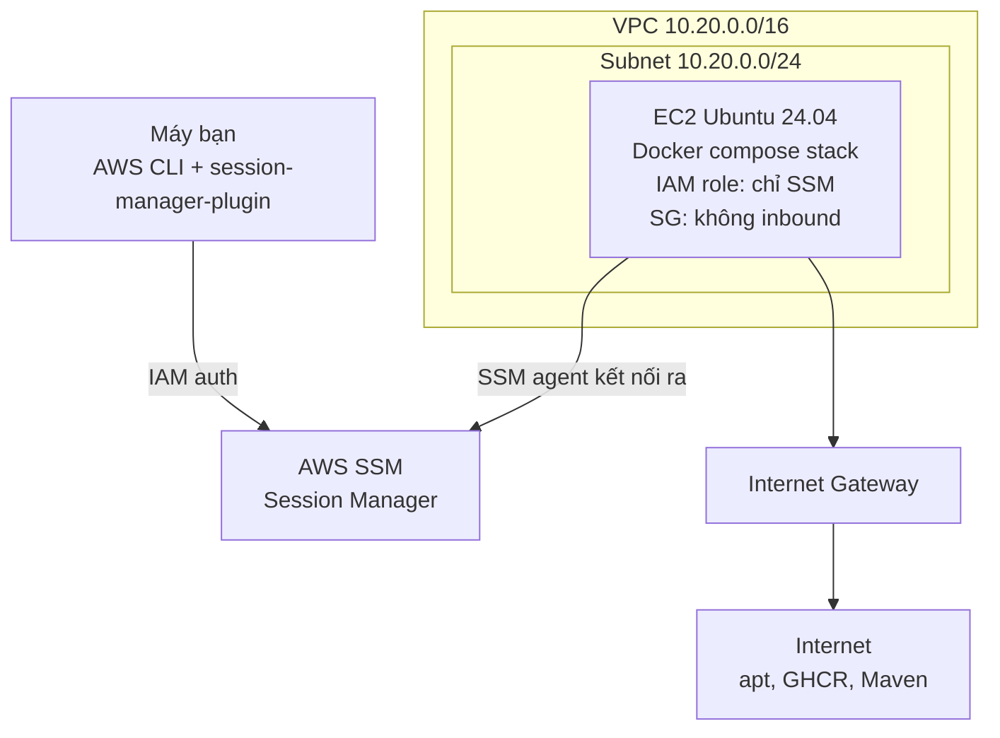

# Terraform cho project: thành phần và câu lệnh

Tài liệu tóm tắt những gì cần biết về Terraform để dựng, vận hành và xoá hạ tầng AWS của project này ([infra/aws/](.)). Cách deploy stack lên host xem ở [README.md](README.md).

## Mục lục

1. [Terraform làm gì](#1-terraform-làm-gì)
2. [Khái niệm cơ bản](#2-khái-niệm-cơ-bản)
3. [Các file trong thư mục](#3-các-file-trong-thư-mục)
4. [Các thành phần hạ tầng](#4-các-thành-phần-hạ-tầng)
5. [Câu lệnh](#5-câu-lệnh)
6. [Tình huống thường gặp](#6-tình-huống-thường-gặp)
7. [Lưu ý](#7-lưu-ý)

---

## 1. Terraform làm gì

Bạn mô tả hạ tầng **mong muốn** bằng file `.tf`, ví dụ "cần 1 VPC, 1 EC2 loại t3.medium". Terraform so sánh mô tả đó với hạ tầng **đang có**, rồi gọi API AWS để tạo, sửa hoặc xoá cho khớp.

```
 file .tf (mong muốn)  ─┐
                        ├─► terraform plan  ─► danh sách thay đổi ─► terraform apply ─► gọi API AWS
 state (đang có)      ──┘                                                          └─► cập nhật state
```

Lợi ích so với bấm tay trên AWS Console:
- Dựng lại y hệt bất cứ lúc nào.
- Review thay đổi bằng `plan` trước khi áp dụng.
- Xoá sạch bằng một lệnh, không sót resource tốn tiền.

## 2. Khái niệm cơ bản

| Khái niệm | Là gì | Ví dụ trong project |
|---|---|---|
| **Provider** | Plugin biết cách nói chuyện với một nền tảng (AWS, GCP, GitHub...) | `hashicorp/aws` trong [versions.tf](versions.tf) |
| **Resource** | Một thứ Terraform **tạo và quản lý**. Xoá khỏi code thì Terraform xoá trên AWS. | `resource "aws_instance" "host"` |
| **Data source** | Một thứ Terraform chỉ **đọc**, không tạo, không xoá | `data "aws_ami" "ubuntu"`: tìm AMI Ubuntu mới nhất |
| **Variable** | Tham số đầu vào, có giá trị mặc định | `var.instance_type` |
| **Output** | Giá trị in ra sau khi apply, đọc lại bằng `terraform output` | `shell`, `instance_id` |
| **State** | File `terraform.tfstate`: ghi resource nào trong code ứng với ID nào trên AWS | Nằm local, đã gitignore |
| **Lock file** | `.terraform.lock.hcl`: khoá phiên bản provider để ai chạy cũng giống nhau | AWS provider 6.73.0, **có commit** |
| **tfvars** | File gán giá trị cho variable | `terraform.tfvars`: **không commit** vì có email |

### Địa chỉ resource

Mỗi resource có địa chỉ dạng `<type>.<tên>`. Bạn dùng địa chỉ này trong code để tham chiếu và trong các lệnh `state`, `-replace`.

```hcl
resource "aws_subnet" "public" {
  vpc_id = aws_vpc.main.id     # tham chiếu thuộc tính id của resource aws_vpc.main
}
```

- Resource có `count` thì địa chỉ có thêm chỉ số, ví dụ `aws_budgets_budget.monthly[0]`.
- Data source có tiền tố `data.`, ví dụ `data.aws_ami.ubuntu.id`.

### Thứ tự tạo

Thứ tự tạo **không phụ thuộc** thứ tự viết trong file. Terraform dựng đồ thị phụ thuộc từ các tham chiếu:
- Subnet dùng `aws_vpc.main.id`, nên VPC được tạo trước.
- Các resource không phụ thuộc nhau được tạo song song.
- Khi `destroy`, thứ tự đảo ngược lại.

### Cú pháp có dùng trong project

| Cú pháp | Ý nghĩa | Chỗ dùng |
|---|---|---|
| `count = điều_kiện ? 0 : 1` | Bật/tắt một resource | Budget chỉ tạo khi có `budget_email` |
| `lifecycle { ignore_changes = [ami] }` | Bỏ qua thay đổi của một thuộc tính | Không tự thay EC2 khi Ubuntu ra AMI mới |
| `validation { ... }` | Kiểm tra giá trị variable trước khi chạy | `instance_state` chỉ nhận `running` hoặc `stopped` |
| `default_tags` | Gắn tag cho mọi resource | `Project`, `ManagedBy=terraform` |
| `cidrsubnet(cidr, 8, 0)` | Cắt dải IP con | `10.20.0.0/16` thành `10.20.0.0/24` |
| `file(path)` | Đọc nội dung file | Đưa `cloud-init.yaml` vào `user_data` |
| `"${var.project}-host"` | Ghép chuỗi | Tên resource: `mobile-events-host` |

## 3. Các file trong thư mục

Terraform đọc **mọi** file `.tf` trong thư mục như một khối. Chia file chỉ để dễ đọc, tên file không có ý nghĩa gì với Terraform.

| File | Nội dung | Commit? |
|---|---|---|
| [versions.tf](versions.tf) | Phiên bản Terraform/provider, cấu hình provider (region, tag) | Có |
| [variables.tf](variables.tf) | Khai báo variable và giá trị mặc định | Có |
| [main.tf](main.tf) | Network, security group, IAM, EC2 | Có |
| [budget.tf](budget.tf) | Cảnh báo chi phí | Có |
| [outputs.tf](outputs.tf) | Lệnh SSM in sẵn, ID instance | Có |
| [cloud-init.yaml](cloud-init.yaml) | Script cài Docker, chạy lúc EC2 boot lần đầu | Có |
| [terraform.tfvars.example](terraform.tfvars.example) | Mẫu cho `terraform.tfvars` | Có |
| [.terraform.lock.hcl](.terraform.lock.hcl) | Khoá phiên bản provider | Có |
| `terraform.tfvars` | Giá trị thật của bạn | **Không** |
| `terraform.tfstate`, `terraform.tfstate.backup` | State | **Không** (mất file này là Terraform "quên" hạ tầng, xem [Lưu ý](#7-lưu-ý)) |
| `.terraform/` | Provider đã tải về (~700 MB) | **Không** |

## 4. Các thành phần hạ tầng



EC2 **chủ động kết nối ra** SSM. Máy bạn cũng kết nối tới SSM, và SSM nối hai đầu lại. Vì vậy security group không cần mở port nào chiều vào.

### 4.1 Data source: AMI và Availability Zone

| Data source | Đọc gì | Tại sao |
|---|---|---|
| `data.aws_availability_zones.available` | Danh sách AZ trong region | Đặt subnet vào AZ đầu tiên, không hardcode `ap-southeast-1a` |
| `data.aws_ami.ubuntu` | AMI Ubuntu 24.04 mới nhất của Canonical (owner `099720109477`) | Lọc theo owner để không dùng nhầm AMI giả mạo trùng tên |

### 4.2 Network

| Resource | Vai trò |
|---|---|
| `aws_vpc.main` | Mạng riêng của project, tách khỏi default VPC. Bật DNS để resolve được endpoint AWS. |
| `aws_internet_gateway.main` | Cổng ra internet của VPC |
| `aws_subnet.public` | Dải IP con nơi đặt EC2 |
| `aws_route_table.public` + `aws_route_table_association.public` | Quy tắc định tuyến: mọi traffic `0.0.0.0/0` đi qua Internet Gateway. Association gắn bảng này vào subnet. |
| `aws_default_security_group.default` | Mỗi VPC có sẵn một security group mặc định. Khai báo không rule để Terraform **xoá hết rule** của nó, tránh resource nào vô tình dùng phải. |

Gọi là "public subnet" vì có route ra internet. Có route ra không có nghĩa là có cổng vào: chiều vào do security group quyết định.

### 4.3 Security group: tường lửa của EC2

| Resource | Vai trò |
|---|---|
| `aws_security_group.host` | Tường lửa gắn vào EC2. **Không có rule inbound.** |
| `aws_vpc_security_group_egress_rule.host_all` | Cho phép mọi traffic chiều ra (apt, pull image, SSM) |

Security group là **stateful**: một kết nối do EC2 mở ra thì gói trả về tự được phép vào. Không có rule inbound chỉ chặn các kết nối **do bên ngoài mở**.

Rule được viết thành resource riêng (`aws_vpc_security_group_egress_rule`) thay vì block `egress {}` lồng trong security group. Đây là cách AWS provider khuyến nghị: thêm hoặc xoá một rule không làm Terraform viết lại cả security group.

### 4.4 IAM: quyền của EC2

| Resource | Vai trò |
|---|---|
| `data.aws_iam_policy_document.ec2_assume` | Trust policy: chỉ dịch vụ EC2 được "đeo" role này |
| `aws_iam_role.host` | Role của EC2 |
| `aws_iam_role_policy_attachment.host_ssm` | Gắn policy có sẵn `AmazonSSMManagedInstanceCore`: vừa đủ để SSM agent đăng ký và nhận session |
| `aws_iam_instance_profile.host` | Lớp bọc để gắn role vào EC2 (EC2 không nhận role trực tiếp) |

Role **không có** quyền S3, EC2 hay gì khác. Nếu host bị chiếm, kẻ tấn công cũng không dùng role này để đụng vào phần còn lại của account được.

### 4.5 EC2

`aws_instance.host`:

| Thuộc tính | Giá trị | Giải thích |
|---|---|---|
| `ami` | `data.aws_ami.ubuntu.id` | Ubuntu 24.04 |
| `instance_type` | `var.instance_type` | Đổi rồi `apply` là AWS stop → đổi loại → start, dữ liệu giữ nguyên |
| `associate_public_ip_address` | `true` | Cần IP public để **đi ra** internet (không dùng NAT Gateway vì tốn ~$45/tháng). IP đổi mỗi lần stop/start. |
| `user_data` | `cloud-init.yaml` | Script chạy **một lần** lúc boot đầu tiên: cài Docker, compose, git, make; tạo `/opt/mobile-events`. Log ở `/var/log/cloud-init-output.log`. |
| `metadata_options` | `http_tokens = "required"`, `hop_limit = 1` | Bắt buộc IMDSv2. Hop limit 1 nghĩa là chỉ process trên host đọc được metadata, container (thêm 1 hop mạng) thì không, nên container không lấy được credential của role. |
| `root_block_device` | gp3, `var.root_volume_size` GB, `encrypted = true` | Ổ chứa OS, Docker image và volume (Postgres, Kafka, MinIO) |
| `lifecycle.ignore_changes` | `[ami]` | Canonical ra AMI mới hằng tuần. Không có dòng này thì mỗi lần `apply` sau đó, Terraform sẽ đòi **xoá và tạo lại** EC2, mất hết dữ liệu. |

`aws_ec2_instance_state.host` giữ trạng thái chạy/tắt của EC2 theo `var.instance_state`. Tắt máy bằng code thay vì vào Console bấm Stop, nên `plan` luôn phản ánh đúng thực tế.

### 4.6 Budget

`aws_budgets_budget.monthly` (chỉ tạo khi `budget_email` khác rỗng):
- Áp cho **cả account**, không chỉ resource của project, vì EC2 bị quên ở project khác cũng là tiền của bạn.
- Gửi email khi **dự báo** cuối tháng vượt 80% ngưỡng, và khi chi **thực tế** vượt 100%.
- Budget chỉ **báo**, không tự tắt resource. AWS cập nhật số liệu chi phí vài lần mỗi ngày, nên email có thể đến trễ vài giờ.
- Lần đầu AWS gửi email xác nhận subscription, cần bấm xác nhận.

### 4.7 Variable

| Variable | Mặc định | Ghi chú |
|---|---|---|
| `region` | `ap-southeast-1` | Singapore |
| `project` | `mobile-events` | Tiền tố tên và tag |
| `instance_type` | `t3.medium` | Backend platform. Full stack: `m6i.xlarge` |
| `root_volume_size` | `40` | GB. Tăng được, **không giảm được** |
| `instance_state` | `running` | `running` / `stopped` |
| `vpc_cidr` | `10.20.0.0/16` | Đổi sau khi đã apply sẽ tạo lại cả mạng lẫn EC2 |
| `budget_email` | `""` | Rỗng = không tạo budget |
| `budget_monthly_usd` | `50` | USD/tháng |

Thứ tự ưu tiên khi gán giá trị, cao nhất trước: `-var` trên dòng lệnh, rồi `terraform.tfvars`, rồi `default` trong [variables.tf](variables.tf).

### 4.8 Output

| Output | Giá trị |
|---|---|
| `instance_id` | ID của EC2, ví dụ `i-0abc...` |
| `private_ip` | IP trong VPC |
| `shell` | Lệnh mở shell qua SSM |
| `port_forward_example` | Lệnh port-forward Metabase (port 3000) về máy bạn |

## 5. Câu lệnh

Mọi lệnh `terraform` chạy trong thư mục `infra/aws/`.

### 5.1 Chuẩn bị (một lần)

```bash
aws configure                     # nhập access key; hoặc: aws configure sso && aws sso login
aws sts get-caller-identity       # kiểm tra đã đăng nhập đúng account
session-manager-plugin --version  # kiểm tra plugin SSM đã cài

cd infra/aws
cp terraform.tfvars.example terraform.tfvars   # rồi sửa giá trị
terraform init                    # tải provider vào .terraform/, đọc lock file
```

### 5.2 Vòng làm việc chính

| Lệnh | Làm gì |
|---|---|
| `terraform fmt` | Format lại code `.tf` (thêm `-check` để chỉ kiểm tra, dùng trong CI) |
| `terraform validate` | Kiểm tra cú pháp và kiểu dữ liệu, không gọi AWS |
| `terraform plan` | Xem sẽ thay đổi gì, **không** thay đổi gì cả |
| `terraform plan -out=tfplan` | Lưu plan ra file để apply đúng plan đã review |
| `terraform apply` | Plan lại, hỏi `yes`, rồi thực hiện |
| `terraform apply tfplan` | Thực hiện đúng plan đã lưu, không hỏi lại |
| `terraform destroy` | Xoá **toàn bộ** resource trong state (hỏi `yes`) |

Ký hiệu trong output của `plan`:

| Ký hiệu | Nghĩa | Mức độ |
|---|---|---|
| `+` | Tạo mới | Bình thường |
| `~` | Sửa tại chỗ (update in-place) | Thường an toàn |
| `-/+` hoặc `+/-` | **Xoá rồi tạo lại** (replace) | **Nguy hiểm với EC2: mất dữ liệu** |
| `-` | Xoá | Kiểm tra kỹ |
| `<=` | Đọc data source | Bình thường |

Dòng cuối cho biết tổng số thay đổi, ví dụ `Plan: 1 to add, 0 to change, 1 to destroy.` Thấy `aws_instance.host` bị `destroy` thì **dừng lại đọc kỹ** trước khi gõ `yes`.

### 5.3 Xem thông tin

| Lệnh | Làm gì |
|---|---|
| `terraform output` | In mọi output |
| `terraform output -raw instance_id` | In một output, không có dấu ngoặc kép (dùng trong script) |
| `terraform state list` | Liệt kê resource Terraform đang quản lý |
| `terraform state show aws_instance.host` | Xem toàn bộ thuộc tính của một resource (IP, AMI, volume ID...) |
| `terraform show` | In toàn bộ state dạng dễ đọc |
| `terraform providers` | Liệt kê provider và phiên bản |
| `terraform console` | Thử biểu thức, ví dụ `cidrsubnet("10.20.0.0/16", 8, 0)`, `var.region` |
| `terraform graph \| dot -Tpng > graph.png` | Vẽ đồ thị phụ thuộc (cần Graphviz) |

### 5.4 Truy cập host (AWS CLI)

Các output có dấu nháy trong JSON, nên chạy qua `eval`. Chạy `$(...)` trực tiếp sẽ truyền nguyên dấu nháy vào lệnh và AWS CLI báo lỗi JSON.

```bash
eval "$(terraform output -raw shell)"                 # mở shell trên host (user ssm-user)
sudo -iu ubuntu                                       # chuyển sang user có quyền docker

eval "$(terraform output -raw port_forward_example)"  # Metabase tại http://localhost:3000

# Port-forward port khác, ví dụ Trino 8050:
aws ssm start-session --region ap-southeast-1 \
  --target "$(terraform output -raw instance_id)" \
  --document-name AWS-StartPortForwardingSession \
  --parameters '{"portNumber":["8050"],"localPortNumber":["8050"]}'

# Kiểm tra SSM agent đã đăng ký chưa (PingStatus = Online):
aws ssm describe-instance-information --region ap-southeast-1 \
  --query 'InstanceInformationList[].{id:InstanceId,ping:PingStatus}'
```

Port-forward giữ terminal; nhấn `Ctrl+C` để đóng.

### 5.5 Thao tác nâng cao

| Lệnh | Khi nào dùng |
|---|---|
| `terraform apply -var instance_state=stopped` | Ghi đè variable một lần. Lần `apply` sau mà không có `-var` sẽ quay lại giá trị trong tfvars, nên **ưu tiên sửa tfvars**. |
| `terraform apply -replace=aws_instance.host` | Cố ý tạo lại EC2 (lên AMI mới, chạy lại cloud-init). **Mất dữ liệu trên host.** |
| `terraform plan -refresh-only` | Xem AWS thực tế đã lệch khỏi state thế nào (ai đó sửa tay trên Console) |
| `terraform apply -refresh-only` | Chấp nhận thực tế đó vào state, không sửa gì trên AWS |
| `terraform apply -target=aws_budgets_budget.monthly` | Chỉ apply một resource. Dùng khi gỡ rối, không dùng thường xuyên. |
| `terraform init -upgrade` | Nâng provider lên bản mới nhất trong khoảng `~> 6.0` và cập nhật lock file (nhớ commit lock file) |
| `terraform state rm <địa_chỉ>` | Bỏ resource khỏi state **mà không xoá** trên AWS |
| `terraform import <địa_chỉ> <id>` | Đưa resource đã có trên AWS vào state |

## 6. Tình huống thường gặp

| Muốn | Làm |
|---|---|
| Dựng lần đầu | `cp terraform.tfvars.example terraform.tfvars` → sửa → `terraform init` → `terraform apply` → đợi 2–3 phút cho cloud-init |
| Tắt máy cuối ngày | `instance_state = "stopped"` trong tfvars → `terraform apply` |
| Bật máy lại | `instance_state = "running"` → `terraform apply` |
| Chạy full stack | `instance_type = "m6i.xlarge"` → `terraform apply` (EC2 tự stop, đổi loại, start) |
| Hết ổ đĩa | Tăng `root_volume_size` → `terraform apply`; trên host chạy `sudo growpart /dev/nvme0n1 1 && sudo resize2fs /dev/nvme0n1p1` nếu `df -h` chưa thấy dung lượng mới |
| Sửa `cloud-init.yaml` | Host đang chạy **không** chạy lại cloud-init. Phải `terraform apply -replace=aws_instance.host` (mất dữ liệu) hoặc tự chạy lệnh tương ứng trên host. |
| Lên AMI Ubuntu mới | `terraform apply -replace=aws_instance.host`. Hằng ngày thì `unattended-upgrades` đã tự vá bảo mật. |
| Không vào được shell | Đợi vài phút sau khi bật máy; chạy `aws ssm describe-instance-information`; xem log trên Console: EC2 → Actions → Monitor → Get system log |
| Xong việc, không dùng nữa | `terraform destroy` → gõ `yes`. Kiểm tra `terraform state list` rỗng. |

## 7. Lưu ý

- **State là nguồn sự thật của Terraform.** Mất `terraform.tfstate` thì resource vẫn chạy (và tính tiền) trên AWS, nhưng Terraform không biết để quản lý hay xoá nữa. Hiện state để local cho một người dùng. Khi có nhiều người cùng `apply` hoặc chạy từ CI, chuyển sang backend S3 có lock (`use_lockfile = true`).
- **State chứa dữ liệu nhạy cảm** (ở project này là email budget) dưới dạng plain text. Không commit, không gửi đi.
- **Không sửa tay trên Console** những resource Terraform quản lý. Lần `apply` sau, Terraform sẽ ghi đè về như code. Nếu lỡ sửa, dùng `plan -refresh-only` để xem độ lệch.
- **Luôn đọc `plan` trước khi `yes`**, đặc biệt các dòng `-/+` trên `aws_instance.host`.
- **Chi phí còn lại khi đã stop:** ổ EBS (~$4/tháng cho 40 GB) vẫn tính. Muốn về $0 thì `terraform destroy`.
- **Một số thay đổi buộc tạo lại EC2**, Terraform ghi rõ `# forces replacement` trong plan: đổi `vpc_cidr`, subnet, `user_data` (khi bật `user_data_replace_on_change`), giảm `root_volume_size`...
